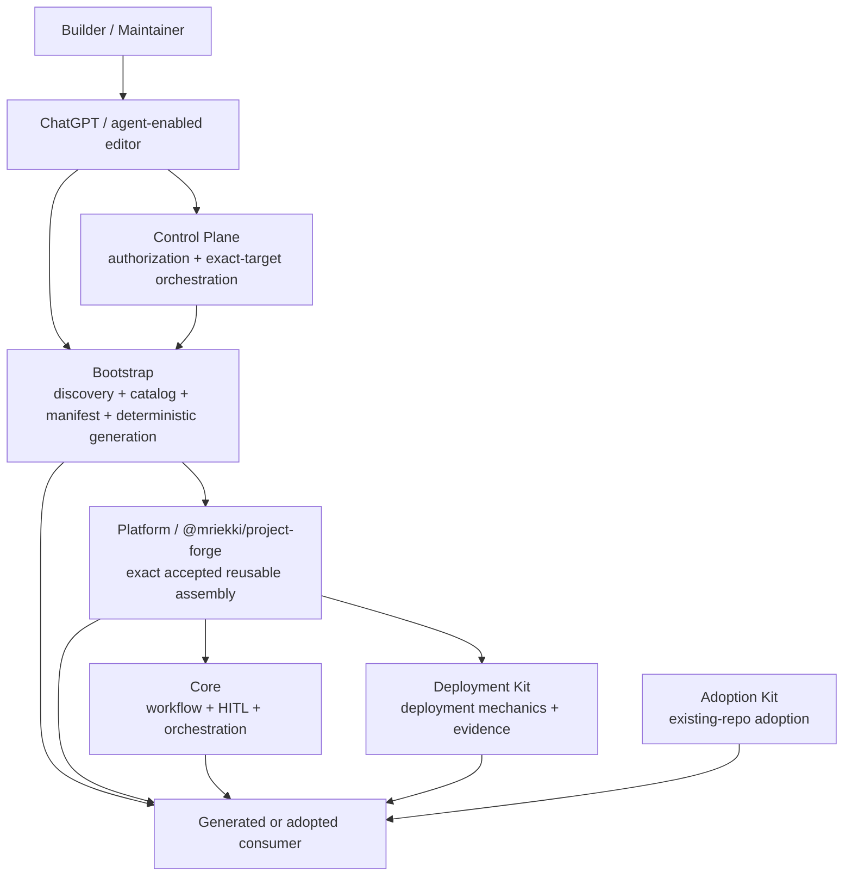

# Project Forge System Design

## Purpose

This document is the canonical **cross-repository design map** for the Project Forge foundational system. It explains how the foundational repositories relate, where authority lives, how major lifecycle flows cross repository boundaries, and where a maintainer or AI assistant should go for detailed current evidence.

It intentionally does **not** duplicate implementation algorithms, current commit SHAs, current package/catalog versions, open-issue status, or consumer-specific product/application design. Those facts change more frequently and remain owned by machine-readable state and the repository that implements them.

The companion [`PROJECT_FORGE_SYSTEM_REQUIREMENTS.md`](PROJECT_FORGE_SYSTEM_REQUIREMENTS.md) is normative. This document is explanatory.

## Scope

Foundational Project Forge repositories:

- `mriekki/project-forge-core`
- `mriekki/project-forge-bootstrap`
- `mriekki/project-forge-deployment-kit`
- `mriekki/project-forge-adoption-kit`
- `mriekki/project-forge-platform`
- `mriekki/project-forge-control-plane`

Generated or adopted software repositories are **consumers**, not foundational repositories. They are described here only at their boundary with Project Forge. A consumer remains authoritative for its own product requirements, application architecture, code/tests, deployment values, work items, accepted baselines, and delivery history.

## How to use this document

For a system-wide analysis:

1. read the system requirements first;
2. use this design to identify the owning repository and relevant interface;
3. inspect the owning repository's live implementation, tests, and machine-readable contracts for current-state evidence;
4. inspect Platform/Bootstrap/Control Plane provenance records when exact accepted versions or commits matter;
5. treat any mismatch between a normative system requirement and live implementation as a defect, intentional pending migration, or requirements-change decision that must be made explicit.

Do not reconstruct current system state from historical migration handoffs or consumer examples when live foundational evidence exists.

---

## 1. Authority model

Project Forge separates **normative intent**, **explanatory design**, and **current implementation evidence**.

### Normative cross-repository authority

`docs/system/PROJECT_FORGE_SYSTEM_REQUIREMENTS.md` defines invariants that the foundational repositories are intended to satisfy together.

An implementation does not silently override a system requirement merely because it exists. If live behavior violates a requirement, analysis should report the mismatch. The resolution is either:

- fix the owning implementation;
- explicitly change the requirement through review; or
- document a bounded migration state until the two converge.

### Detailed implementation authority

Each foundational repository owns the detailed contracts and mechanics inside its responsibility boundary. Its checked-in code, tests, schemas, distributions, workflows, and machine-readable state are the source for what is implemented now.

### Explanatory authority

This design document describes relationships and stable architectural intent. It should point to owning-repository detail rather than copy it.

### Historical and example material

Briefings, migration handoffs, old consumer examples, issue discussions, and retired names are supporting evidence only. They do not override current requirements or live owning-repository contracts.

### Two questions, two sources

| Question | Primary source |
| --- | --- |
| What must Project Forge preserve across repositories? | System requirements |
| What does repository X implement right now? | Repository X live code/contracts/tests |
| Which exact reusable component commits are in the current public package? | Platform `assets/components.json` |
| Which Bootstrap generation revision/package does the stable ChatGPT entrypoint resolve? | Platform `chatgpt/current.json` |
| Which stacks/tools/targets are currently cataloged and at what support state? | Bootstrap `catalog/CATALOG.json` and referenced catalog entries |
| What exactly generated this consumer? | Consumer `PROJECT_BOOTSTRAP.json` + package/component baselines |

---

## 2. Foundational ownership map

### `project-forge-core` — reusable engineering workflow

Owns reusable Project Forge workflow behavior and Human-in-the-Loop semantics, including agents/skills/instructions/process guidance, setup orchestration, implementation/review/delivery behavior, learning flows, package-update orchestration, upstream-defect handoff, deployment orchestration, and destructive-operation policy.

Core owns **human-facing orchestration and gates**, not the deployment implementation itself and not product/application-specific architecture.

Canonical detail entrypoints:

- `README.md`
- `core/instructions/project-forge-workflow.instructions.md`
- `core/process/PROJECT_FORGE_ENGINEERING_GUIDE.md`
- `core/process/DEPLOYMENT_ENABLEMENT.md`
- `core/process/PROJECT_DOCUMENTATION_FRAMEWORK.md`
- `core/skills/setup/SKILL.md`
- `core/skills/deployment-readiness/SKILL.md`
- `core/skills/deploy/SKILL.md`
- `core/skills/deliver/SKILL.md`
- `core/skills/project-forge-update/SKILL.md`
- `core/skills/upstream-fix/SKILL.md`
- `distributions/greenfield-workspace.json`

### `project-forge-bootstrap` — definition, catalog, and deterministic generation

Owns New Project discovery, imported discovery, accepted manifest schema/protocol, catalog/support-state definitions, recipes, generation policy, deterministic project/workspace generation, scaffold/setup/doctor shell generation, product/work-item materialization, and selection of one exact public Project Forge package/profile for generation.

Bootstrap owns the distinction between **conversational discovery** and **deterministic post-approval generation**. It does not independently reassemble private Core or Deployment Kit sources during normal generation.

Canonical detail entrypoints:

- `README.md`
- `docs/ARCHITECTURE.md`
- `docs/NEW_PROJECT_PROTOCOL.md`
- `docs/discovery/QUESTION_MODEL.md`
- `catalog/CATALOG.json`
- `catalog/policies/agentic-workspace-shell.json`
- `catalog/policies/generation-destination.json`
- `schemas/`
- `recipes/`
- `tools/generate.py`
- `tools/generate_snapshot.py`

### `project-forge-deployment-kit` — deterministic deployment mechanics

Owns reusable deployment mechanics: workstation runtime, remote targets and strict access, host-platform state, environment proof, application runtime, isolation preflight, routes, persistence, target binding mechanics, evidence, and scoped tear-down.

Deployment Kit owns **mechanics and deterministic evidence**. Core decides how those mechanics are conversationally orchestrated and which human authorizations are required. Bootstrap decides whether a deployment choice is cataloged/supported.

Canonical detail entrypoints:

- `README.md`
- `docs/DEPLOYMENT_TOPOLOGY.md`
- `docs/DEVELOPER_ENVIRONMENTS.md`
- `docs/TARGET_ACCESS.md`
- `docs/ENVIRONMENT_PROOF.md`
- `docs/APPLICATION_DEPLOYMENT.md`
- `docs/LOCAL_APPLICATION_DEPLOYMENT.md`
- `docs/SQLITE_ADAPTER.md`
- `docs/TEAR_DOWN.md`
- `distributions/greenfield-project.json`
- `src/project_forge_deployment/`

### `project-forge-adoption-kit` — existing-repository adoption product

Owns applying selected Project Forge capabilities to an existing software repository without forcing greenfield project structure or overwriting existing engineering conventions.

Adoption Kit consumes reusable Core payload content but owns the adoption discovery, preflight, planning, apply, validation, baseline, and adopted-repository update model. Existing repository conventions outrank Project Forge defaults unless the developer explicitly chooses otherwise.

Canonical detail entrypoints:

- `README.md`
- `docs/ADOPTION_SYSTEM_FLOW.md`
- `docs/ADOPTION_UPDATE_ENGINE.md`
- `docs/ADOPTION_UPDATE_VALIDATION.md`
- `installer/`
- `payload/`
- `manifests/`

### `project-forge-platform` — public assembly and umbrella contract

Owns the public `@mriekki/project-forge` package, exact accepted reusable-component assembly, package profiles/distribution descriptors, umbrella package update/check behavior, release automation, and public ChatGPT contract/descriptor.

Platform is the appropriate home for this cross-repository system reference because it is the umbrella assembly/public-contract boundary, not because it owns the internal mechanics of the sibling repositories.

Canonical detail entrypoints:

- `README.md`
- `assets/components.json`
- `docs/RELEASE_PROCESS.md`
- `chatgpt/current.json`
- `chatgpt/contracts/`
- `scripts/prepare-package-update.mjs`
- `scripts/prepare-release.mjs`
- `.github/workflows/npm-publish.yml`

### `project-forge-control-plane` — GitHub-first authorization and orchestration

Owns Builder authorization/onboarding, public request validation, GitHub App credential isolation, exact-target tokens, GitHub-first generation orchestration, and safe non-force publication to private target repositories.

The Control Plane orchestrates Bootstrap; it does not redefine Bootstrap's manifest/catalog/generation contract and does not become the source of private product definition.

Canonical detail entrypoints:

- `README.md`
- `docs/SETUP.md`
- `docs/ADMIN_SETUP.md`
- `docs/INVITATIONS.md`
- `config/developers.json`
- `.github/workflows/generate-project.yml`
- `.github/workflows/onboarding-doctor.yml`
- `tools/project_forge_contract.py`

---

## 3. System topology



The arrows represent **contract/delivery relationships**, not repository ownership transfer.

---

## 4. Greenfield lifecycle and repository handoffs

### Phase A — discovery and definition

```text
idea / imported product evidence
→ Bootstrap discovery protocol
→ users/workflows/state/data/security/deployment/learning choices
→ catalog + recipe reconciliation
→ V1 scope/non-goals/work items
→ human-approved PROJECT_BOOTSTRAP.json
```

Bootstrap owns the discovery model and manifest contract. Recommendations remain recommendations until accepted. Catalog support state constrains automation claims.

### Phase B — GitHub-first generation

For the normal ChatGPT path:

```text
approved private target + PROJECT_BOOTSTRAP seed
→ bounded public [generate-project] request
→ Control Plane authorization/owner validation
→ exact accepted Bootstrap provenance resolution
→ exact-target short-lived credential
→ Bootstrap validation + deterministic generation
→ exact public Project Forge package acquisition/integrity verification
→ package whole-profile preflight/apply
→ generated baselines
→ non-force publication
→ generated default-branch CI
```

The public request does not carry private product definition. Failure to obtain the exact approved source/package/target is a stop condition rather than permission to silently substitute another path.

### Phase C — workstation setup and acceptance

```text
clone/fetch generated repository
→ /setup
→ installed vs operational readiness
→ workspace doctor/readiness
→ editor/agent discovery
→ human workspace acceptance
→ substantive work
```

Generation success, setup success, and doctor success are evidence. None substitutes for human acceptance of the working checkout.

### Phase D — work and delivery

```text
/start-work <ID>
→ bounded implementation
→ tests
→ Reviewer evidence
→ human meaningful-diff acceptance
→ optional learning
→ /deliver
→ selective stage / staged-diff check / commit / push / PR / CI
→ one merge/finalize gate
→ merge
→ post-merge default-branch CI
→ safe delivered-branch cleanup
```

Core owns these workflow semantics. The consumer owns its actual code, tests, product decisions, and work-item state.

### Phase E — deployment when selected

```text
consumer deployment topology + app facts
→ Core /deployment-readiness
→ deterministic Deployment Kit status/isolation/proof evidence
→ bounded deployment plan
→ required human authorization
→ Deployment Kit mutation
→ post-deploy health/route/smoke/evidence
```

Deployment readiness is not deployment authorization. Environment proof is not application deployment. Merge is not Production deployment. Production remains separately classified and separately authorized regardless of physical placement.

### Phase F — reusable updates

Package-managed generated consumers use the public package as the reusable update boundary:

```text
new published @mriekki/project-forge version
→ /project-forge-update preview
→ baseline/drift/collision checks
→ bounded apply choice
→ exact package update
→ umbrella + component baseline verification
```

A package publication does not automatically update consumers.

---

## 5. Public package assembly and provenance

Platform assembles the public reusable package from exact accepted component revisions declared in:

```text
project-forge-platform/assets/components.json
```

The package profile determines which reusable components/distributions are included. Canonical component repositories remain the implementation source; the npm package is the public delivery boundary.

Release preparation verifies that Platform's packaged distribution descriptors match the descriptors from the exact accepted component revisions. Publication is a separate human gate and uses the exact approved Platform source/version/component tuple.

Do **not** put current component SHAs in this design. Resolve them from `assets/components.json` when current analysis requires them.

---

## 6. Generation provenance

The stable public ChatGPT descriptor is:

```text
project-forge-platform/chatgpt/current.json
```

It separates:

- immutable contract snapshot identity/provenance for an already resolved ChatGPT contract; and
- mutable generation pointers for the currently accepted Bootstrap revision and public package choice.

Bootstrap's approved `PROJECT_BOOTSTRAP.json` records human-relevant generation authority and, after generation, exact package integrity. It does not need to duplicate package-internal component commits because the package baseline owns those details.

The resulting consumer provenance chain is conceptually:

```text
public ChatGPT descriptor
→ accepted Bootstrap protocol/catalog revision
→ approved PROJECT_BOOTSTRAP.json
→ exact @mriekki/project-forge package + integrity
→ Platform package component pins
→ PROJECT_FORGE_BASELINE.json
   + CORE_BASELINE.json
   + DEPLOYMENT_BASELINE.json (when profile includes Deployment)
```

Each layer answers a different provenance question; they should not be collapsed into one duplicated version ledger.

---

## 7. Consumer ownership boundary

Generated consumers own application/product state, including:

- product requirements and accepted decisions;
- application architecture and source code;
- tests and CI results;
- approved work items and implementation history;
- application image/package identity and runtime/health contract;
- persistence/migration configuration;
- named environment intent and concrete target/provider bindings;
- repository-specific security/privacy decisions;
- accepted Project Forge/package/component baselines.

Foundational repositories must not infer that a platform-level default can overwrite an explicit consumer decision or unrelated consumer file.

Package-managed files are governed by baselines and managed-path collision/drift rules. Consumer-owned files remain outside that mutation boundary.

---

## 8. Setup, scaffold, readiness, and acceptance

These states are deliberately distinct:

```text
generation
≠ workstation setup
≠ operational readiness / doctor
≠ application scaffold
≠ human workspace acceptance
≠ deployment readiness
≠ deployment proof
≠ application deployment
```

Bootstrap owns generated setup/scaffold/doctor shell contracts. Core owns the conversational `/setup` lifecycle and human-facing state/gates. Deployment Kit owns deployment-target setup/proof mechanics.

A tool being installed does not prove it is operational. A machine check passing does not prove the human accepts the workspace. A deployment path proof passing does not prove an application has been deployed.

---

## 9. Deployment architecture

Keep the following dimensions separate:

```text
environment purpose/role
→ placement
→ isolation
→ exposure
→ binding state / adapter
→ target/provider
→ physical failure domain
```

Logical Staging and Production may be on separate machines or share a host. Colocation must be surfaced; it never merges runtime/data/authorization ownership and never turns Staging evidence into Production evidence.

Current reusable deployment mechanics and current catalog support maturity are intentionally different concepts:

- Deployment Kit implementation/tests prove mechanics exist in the canonical component.
- Package-delivered unrelated-consumer proof is required before Bootstrap promotes corresponding catalog support claims.

Always resolve current support state from Bootstrap catalog evidence rather than from this document.

### Isolation and shared-host safety

Real application deployment must consider more than a container name. The deterministic Deployment Kit layer owns environment isolation evidence across the managed footprint, including relevant runtime/route/persistence ownership. Core consumes that evidence and stops before mutation when it is blocked or stale.

Shared host infrastructure is not application-Project-owned. Project-scoped deploy or tear-down must preserve shared platform resources and unrelated Projects.

---

## 10. Security and credential boundaries

Key system boundaries:

- private consumer product definitions remain in consumer repositories;
- the public Control Plane accepts bounded target identifiers, not private product content;
- GitHub App tokens are short-lived and scoped to the required source/target boundary;
- normal generated-consumer development does not require credentials for private foundational repositories;
- package publication uses the release workflow's trusted publishing boundary;
- Production deployment and destructive Production data operations require authorization distinct from merge/release/setup/proof;
- secrets are not persisted in repository documentation, generated system-reference files, or public request bodies.

Repository-local security details remain in the owning repository's workflows/docs.

---

## 11. Existing-repository adoption

Adoption is a different lifecycle from greenfield generation.

```text
existing repository/workspace
→ Adoption Kit read-only preflight + engineering discovery
→ human-confirmed context/capabilities
→ preview
→ Apply adoption gate
→ non-destructive adoption branch
→ validation + meaningful diff
→ human delivery decision
```

Adoption Kit preserves existing engineering conventions and owns its own baseline/update boundary. It uses reusable Core content but must not pretend an existing repository was generated by Bootstrap or governed by a greenfield `PROJECT_BOOTSTRAP.json` unless the repository genuinely has that provenance.

---

## 12. Change and compatibility model

A foundational change should be classified by the boundary it changes:

| Change | Primary owner | Typical cross-repo impact |
| --- | --- | --- |
| Workflow/gate/skill semantics | Core | Platform package; Adoption payload; consumers after update |
| Discovery/catalog/recipe/manifest/generator | Bootstrap | Control Plane generation contract; stable generation pointer |
| Deployment mechanics/evidence/CLI | Deployment Kit | Core orchestration; Platform package; Bootstrap support evidence |
| Existing-repo adoption mechanics | Adoption Kit | Adopted repo baseline/update behavior |
| Package assembly/release/public ChatGPT descriptor | Platform | Generated consumer delivery and new-session bootstrap |
| Authorization/GitHub orchestration | Control Plane | Builder onboarding/generation request behavior; Bootstrap invocation |

A change that alters a **cross-repository invariant or responsibility boundary** requires review against the system requirements and, when needed, a companion Platform system-reference change. Routine internal implementation work that preserves the documented boundary should update only its owning repo.

---

## 13. Failure and recovery principles

Across the system, Project Forge prefers deterministic stop/recovery over silent substitution:

- no force-push as a normal recovery mechanism;
- no automatic fallback from GitHub-first generation to local generation;
- no package/version/source substitution when exact provenance is unavailable;
- no overwrite of unsafe managed drift/collisions;
- no broad deployment cleanup or takeover of unrelated/shared resources;
- no repeated write attempts when deterministic diagnosis shows a different blocker;
- reusable defects should be fixed upstream, while explicitly acknowledged temporary managed drift may allow unrelated consumer-owned work to continue under Core's bounded contract.

Detailed recovery behavior remains owned by the affected repository.

---

## 14. Human-in-the-Loop system gates

The exact wording/mechanics live in Core and owning workflows, but the system preserves distinct human authority for consequential decisions including:

- material scope/requirements;
- substantive plans when warranted;
- human workspace/setup acceptance before substantive work;
- meaningful implementation/diff acceptance;
- final merge/finalize delivery;
- public package/release publication;
- Production deployment;
- destructive Production/persistent-data operations;
- destructive or ownership-changing recovery.

Authorization is bounded. Approval for one gate must not be silently reused for a different consequential action.

---

## 15. Support-state and proof model

Project Forge separates:

```text
implemented mechanics
from
package delivery
from
catalog support claim
from
consumer-specific readiness
```

Source tests in a foundational repo prove source behavior. Platform assembly tests prove package composition. A generated-consumer proof proves the packaged behavior works through the real consumer boundary. Bootstrap catalog promotion should occur only after the evidence required by its support policy exists.

This document deliberately does not say which adapters are currently `partial` or `supported`; current status belongs to the Bootstrap catalog and proof evidence.

---

## 16. Live-state resolution map

Use these sources when current values matter:

| Need | Resolve from |
| --- | --- |
| Current public package version/component commits/distributions | Platform `package.json` + `assets/components.json` |
| Current stable ChatGPT contract and generation pointer | Platform `chatgpt/current.json` |
| Current Bootstrap protocol/catalog/support state | Bootstrap catalog/protocol/schema files |
| Current generation behavior | Bootstrap generator + tests; Control Plane workflow for GitHub-first orchestration |
| Current workflow/HITL behavior | Core instructions/skills/process + tests |
| Current deployment mechanics/evidence | Deployment Kit source/docs/tests/distribution |
| Current adoption behavior | Adoption Kit installer/docs/baseline/update tests |
| Current consumer provenance | Consumer `PROJECT_BOOTSTRAP.json` and baselines |
| Current PR/CI/release/proof status | Live GitHub Actions/issues/PRs and relevant registries |

---

## 17. What this document must not become

Do not turn this file into:

- a duplicate catalog;
- a current-version ledger;
- a list of open issues;
- a copy of every CLI option;
- a copy of schemas or distribution mappings;
- a consumer architecture template;
- a historical migration narrative;
- an excuse to skip live repository verification for current-state claims.

Its job is to make the system understandable enough that detailed research is **targeted**, not eliminated.
